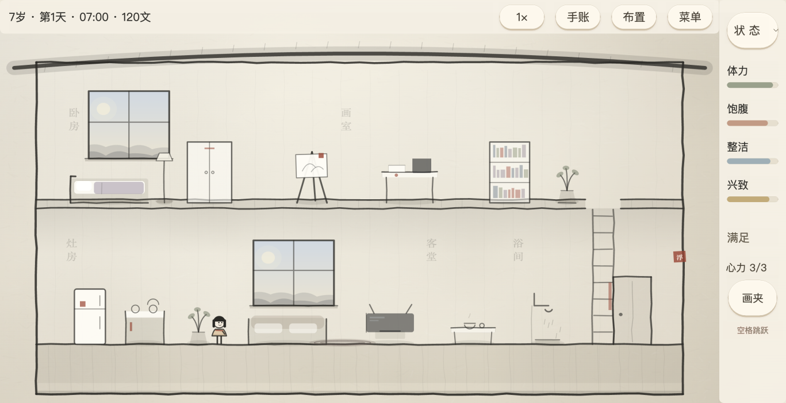

# 浮生 · 纸片屋

一款水墨纸面风格的 2D 生活模拟游戏。角色从七岁开始，每七个游戏日长一岁，
在一间小屋和街坊之间度过童年、少年、青年与成年时光。



## 游戏内容

- 从 7 岁成长到 30 岁，每个阶段有不同的事件和选择。
- 做饭、休息、画画、布置房间，也可以出门拜访街坊或参加市集。
- 作品、关系记忆和房间陈设会随时间保存。
- 支持桌面键鼠和手机横屏触控，存档保存在当前浏览器中，也可以导出存档码。


## 构建与运行

主工程使用 Cocos Creator 3.8.8、TypeScript 和 Node.js。首次运行需要安装
Cocos Creator 3.8.8、Node.js、npm 和 Python 3，然后在终端执行：

```sh
git clone https://github.com/zneghao777/fusheng.git
cd fusheng/fusheng-cocos
npm ci
npm run build:web
npm run serve
```

桌面浏览器访问 <http://127.0.0.1:8088/web-desktop/>。手机和电脑连接同一
Wi-Fi 时，可通过 `http://电脑的局域网地址:8088/web-mobile/` 访问。
服务监听本机所有网络接口，停止服务按 `Ctrl+C`。

构建脚本默认使用 macOS 上的 Creator 3.8.8 安装路径。安装在其他位置或使用
其他系统时，请将环境变量 `COCOS_CREATOR` 设为 Creator 可执行文件的绝对路径。
详细的操作、存档和开发说明见 [Cocos 工程说明](fusheng-cocos/README.md)。

## 测试

在 `fusheng-cocos` 目录下执行：

```sh
npm run content
npm run typecheck
npm test
```

首次打开或构建工程后，Creator 会生成类型检查所需的引擎类型文件。Web 构建完成
并启动本地服务后，可以使用 `npm run test:web` 运行浏览器检查。该检查需要安装
Google Chrome；首次运行前执行 `npx playwright install webkit` 安装 WebKit。

## 项目结构

```text
fusheng-cocos/             Cocos 主工程
  assets/scripts/core/     游戏规则和模拟逻辑
  assets/scripts/ui/       游戏界面
  assets/scripts/platform/ 浏览器平台、存档和音乐
  content/                 游戏内容和文案
  mobile/                  Capacitor Android / iOS 工程
  tests/                   自动化测试
game/index.html            早期 HTML 版本及迁移基线
docs/                      设计资料和截图
```

## 音乐与许可

项目原创内容采用 [MIT 许可证](LICENSE)。第三方依赖和音乐按各自的许可证使用。
仓库中的三首 BGMer 曲目以其[原使用条款](https://bgmer.net/terms/)提供，
不属于 MIT 授权范围。曲名、作者和来源见
[音乐目录](fusheng-cocos/content/music.json)。

另外三首 OpenTracks 曲目不随仓库分发。构建时如果本地没有这些曲目，游戏会
自动使用仓库中可用的音乐；你也可以按照 [音乐还原说明](fusheng-cocos/README.md#音乐)
自行获取并安装，使用时须遵守 [OpenTracks 许可](https://opentracks.com/en/help/articles/license/)。
